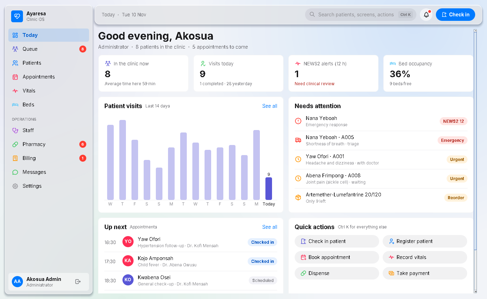
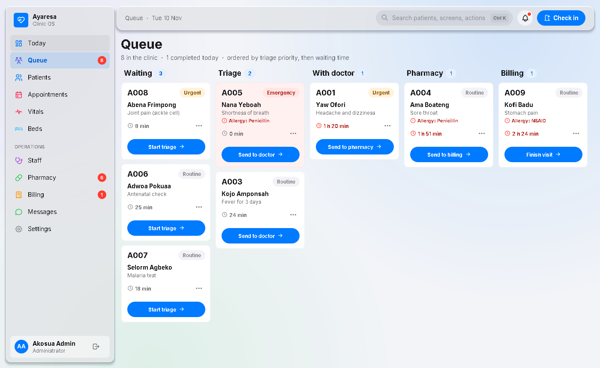
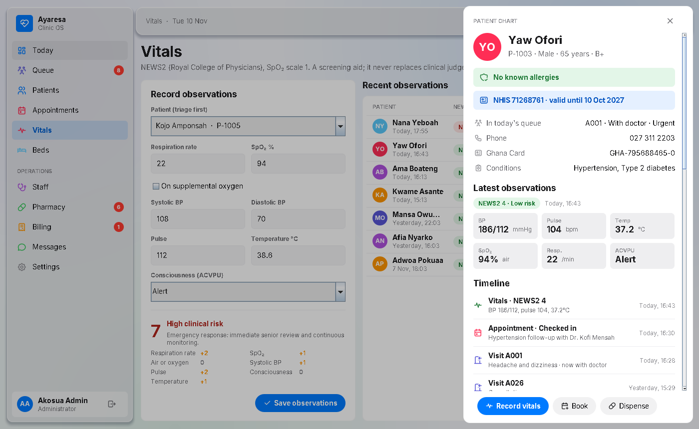
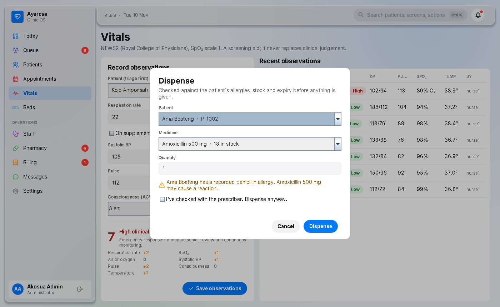
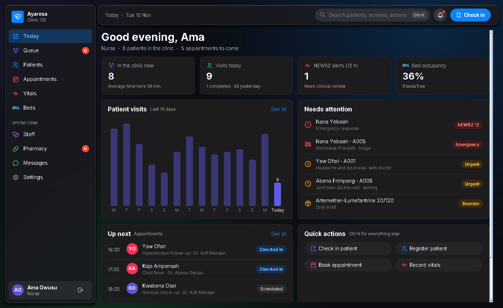

# Ayaresa — Clinic OS

*Ayaresa* is Twi for "healing". It is a desktop clinic management system written in Java 17 and Swing, with an interface in the style of iOS 27 / macOS 27 (Liquid Glass). It is built for small clinics in Ghana: Ghana cedis, NHIS claims, Mobile Money and Ghana Card numbers are all supported.

<p align="center">
  
</p>
<p align="center">
  
  
</p>
<p align="center">
  
  
</p>
<p align="center">
  
  
</p>

---

## Features

The feature set is based on what current clinic and EMR systems offer: real-time queue management with triage priority, early-warning scoring, local billing (NHIS, Mobile Money), pharmacy expiry and reorder alerts, and a complete audit log.

| Area | What it does |
| --- | --- |
| **Today** | A live dashboard for each role: patients in the clinic, a 14-day visit trend, NEWS2 alerts, bed occupancy, stock alerts, money collected, upcoming appointments and quick actions. |
| **Queue** | A patient flow board (Waiting → Triage → Doctor → Pharmacy → Billing). Patients are ordered by triage priority (Emergency, Urgent, Routine), then by waiting time. Each patient gets a token number. Waiting times turn amber after 30 minutes and red after 60. |
| **Patients** | Search by name, ID, phone, Ghana Card or NHIS number. Filter by NHIS status, allergies, admitted or in the clinic today. Export to CSV, with spreadsheet formula injection blocked. |
| **Patient chart** | Allergy and NHIS banners, latest observations, and one timeline of visits, vitals, medicines, appointments and bills. |
| **Vitals** | Automatic **NEWS2** scoring (Royal College of Physicians, SpO₂ scale 1). The score and each parameter's contribution update live while you type. A medium or high score automatically raises the patient's queue priority. |
| **Appointments** | A day view per clinician. Double bookings are blocked. Checking in an appointment adds the patient to the queue. |
| **Beds** | A ward map coloured by each patient's latest NEWS2 risk. Admit and discharge from the map. |
| **Pharmacy** | Stock with reorder levels, expiry tracking (expired items blocked, warning within 90 days) and NHIS cover. Dispensing checks **allergies**, stock and expiry first. Allergy warnings can only be overridden with a confirmation, and the override is recorded. Dispensed medicines are added to the patient's bill automatically. |
| **Billing** | Ghana cedis (using BigDecimal, never floating point). Payment by cash, **Mobile Money** (transaction ID required), card or waiver. **NHIS claims** are only accepted if membership was active on the day of service. Claims can be marked paid or rejected. |
| **Messages** | Team channels (Ward A, Pharmacy, Front desk). |
| **Settings** | Light and dark mode, a **Liquid Glass intensity slider** (like iOS 27), the inactivity sign-out time, an audit log viewer and a demo data reset. |
| **Everywhere** | **Ctrl+K / ⌘K** opens a command palette to search patients, screens and actions. Toasts replace popups. Sidebar badges and toolbar alerts update live. Data is saved between runs. |

## Access control

Who can do what is defined in a single file, `security/AccessPolicy`. Anything not granted is denied. Each screen is `NONE`, `VIEW` or `FULL` for each role. The sidebar, navigation, command palette and every action button read from that one policy. A screen a role can't open is never built.

| Screen | Admin | Doctor | Nurse | Pharmacist | Receptionist |
| --- | --- | --- | --- | --- | --- |
| Today | Full | Full | Full | Full | Full |
| Queue | Full | Full | Full | View | Full |
| Patients | Full | Full | Full | View | Full |
| Appointments | Full | Full | Full | – | Full |
| Vitals | Full | Full | Full | – | – |
| Beds | Full | View | Full | – | – |
| Staff | Full | View | View | – | View |
| Pharmacy | Full | View | View | Full | – |
| Billing | Full | – | – | – | Full |
| Messages | Full | Full | Full | Full | Full |
| Settings | Full | View | View | View | View |

- Passwords are hashed with PBKDF2-HMAC-SHA256 (210,000 iterations, salted, constant-time check), and password buffers are wiped after use.
- An account locks for 60 seconds after 5 failed sign-ins. Error messages never say whether the username or the password was wrong.
- Users are signed out automatically after a period of inactivity (15 minutes by default).
- The audit log records sign-ins, lockouts, denied access and every change to patient data, and it is saved with the data.

Demo accounts: `admin / 1234`, `doctor1 / 3333`, `nurse1 / 2222`, `pharm1 / 4444`, `front1 / 5555`.

## Run it

Requires **Java 17+** and **Maven 3.9+**.

```bash
git clone https://github.com/JerryKaz/Clinic-demo.git
cd Clinic-demo

mvn exec:java                          # run from source
mvn package                            # run the tests and build one runnable jar
java -jar target/ayaresa-4.0.0.jar
```

Data is saved to `~/.ayaresa/clinic.dat`. Delete that file, or use **Settings → Reset demo data**, to start fresh.

## Project layout

```
src/main/java/com/ayaresa/
  Main.java, Brand.java, Preferences.java
  domain/      Patient, QueueEntry, VitalSigns, Appointment, Bed, Drug, Invoice, ... (immutable records)
  clinical/    News2 (early warning score), SafetyCheck (allergy / stock / expiry before dispensing)
  store/       ClinicStore (validation, change events, audit, atomic save), SeedData
  security/    Role, Screen, AccessLevel, AccessPolicy, AuthService, PasswordHasher, AuditLog
  shell/       MainWindow, LoginWindow, Sidebar, Toolbar, CommandPalette, IdleLock
  screens/     Today, Queue, Patients, Appointments, Vitals, Beds, Staff, Pharmacy, Billing, Messages, Settings,
               PatientChart, Sheets (all forms)
  ui/          Theme (light/dark tokens), GlassPanel, Card, DataTable, Sheet, Drawer, Toast, Chips, BarChart, Icons, ...
src/main/resources/com/ayaresa/fonts/   Tabler icon font (MIT)
src/test/java/                         AccessPolicy, AuthService, NEWS2 and ClinicStore tests
```

The product name lives in one place: `Brand.java`.

## Notes

- NEWS2 is a screening aid and doesn't replace clinical judgement. SpO₂ scale 2 isn't offered, because it should only be used under clinician direction.
- Storage is a single local file (Java serialization), which suits a single-PC clinic. For several users at once, swap `ClinicStore`'s save and load for PostgreSQL. The screens don't need to change.

## License

MIT © Jerry Myron
